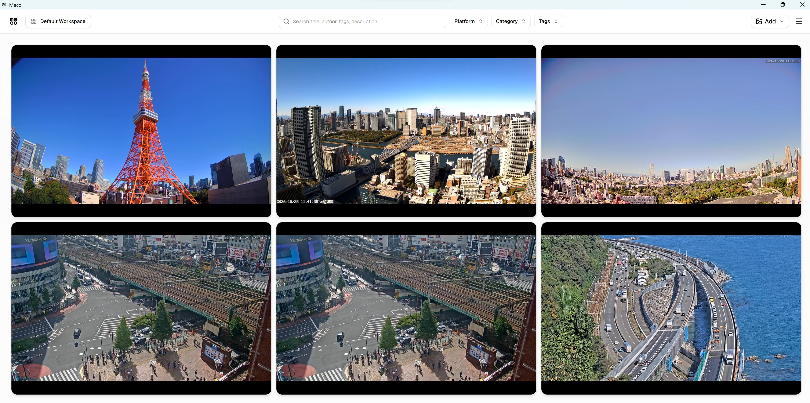

<p align="center">

</p>
<p align="center">

</p>

# Maco

Maco is lightweight frontend, a Live Stream Command Center, that allows you to keep an eye on multiple live streams at a given time. Re-order, re-organize, Re-size as many live streams playing all at once. Manage any number of live streams in any number of workspaces.

## What

Think of Maco as a NVR frontend but for live streams that you want to keep an eye on.

You have multiple workspaces to do deep organization of live streams.

Example: Keep an eye on Public City Cameras, or Nature Reserve Live streams, maybe that live stream of the fishes. You can also keep a track of News Live Streams if you can find one on YouTube.

## Features

- Order, organize, and size each tile to your hearts content.
- Add YouTube Live Stream (or just youtube videos) urls, it automatically pulls some metadata such as Title, Author, and Description.
- Delete Tiles (and subsequently entries) from the `X` in each tile.
- Maximize a title to view it more closer with the Arrow expand icon in each tile.
- Divide up your live streams by workspaces. Add infinite number of workspaces.
- Add any Tile to any number of workspaces
- Export and Import workspaces and all tile information via the Hamburger menu at the top right.
- Search within currently selected workspaces by title, author, tags, description.
- Filter tiles by Platform, Category, and Tags. Each Filter has dropdown multi select with search.
- Move and/or Copy tiles from one workspace to another at will.
- Supports multiple platforms, see the platform list below.

## Supported Platforms

- YouTube
- Twitch
- Kick
- Dailymotion
- Vimeo

## Why?

You know those `hACkeR` style terminals, yeah its something like that. Ever so often I stumble on random live streams, and I thought it would be pretty interesting to watch them all at once.

## Road Map

- Add a backend server that can communicate on behalf of the app. Allowing live streams to be saved and processed with more metadata.
- Add a manual

## Development

### Adding Platforms

All platforms are listed under `/src/platforms/`. You can add platforms under there, and then register it in the `App.tsx`

```tsx
import { registerPlatform } from "./index";

// Extract unique video ID from various YouTube URL formats
function extractYouTubeVideoId(url: string): string | null {
  const patterns = [
    /(?:youtube\.com\/watch\?v=)([a-zA-Z0-9_-]{11})/,
    /(?:youtu\.be\/)([a-zA-Z0-9_-]{11})/,
    /(?:youtube\.com\/embed\/)([a-zA-Z0-9_-]{11})/,
    /(?:youtube\.com\/shorts\/)([a-zA-Z0-9_-]{11})/,
  ];
  for (const pattern of patterns) {
    const match = url.match(pattern);
    if (match) return match[1];
  }
  return null;
}

// Register the platform
registerPlatform("youtube", {
  name: "YouTube",
  extractId: extractYouTubeVideoId,

  // Fetch title, author, and thumbnail using oEmbed
  fetchMetadata: async (url) => {
    try {
      const response = await fetch(
        `https://www.youtube.com/oembed?url=${encodeURIComponent(url)}&format=json`,
      );
      if (response.ok) {
        const data = await response.json();
        return {
          title: data.title,
          author: data.author_name,
          thumbnailUrl: data.thumbnail_url,
        };
      }
    } catch (error) {
      console.error("YouTube oEmbed failed:", error);
    }
    return { title: "YouTube Video" };
  },

  // Render the player iframe
  EmbedComponent: ({ url, title }) => {
    const videoId = extractYouTubeVideoId(url);
    if (!videoId) {
      return (
        <div className="flex h-full items-center justify-center text-sm text-muted-foreground p-4">
          Invalid YouTube URL
        </div>
      );
    }
    return (
      <iframe
        src={`https://www.youtube.com/embed/${videoId}?autoplay=1&mute=1`}
        title={title || "YouTube video"}
        allow="autoplay; encrypted-media"
        allowFullScreen
        className="h-full w-full border-0"
      />
    );
  },
});
```

## Notes

Oh yeah, so technically nothing is stopping you from adding as much YouTube Videos as you want as well, and just putting them on full blast.

This frontend is entirely dependent on your Internet connectivity. Everything will stream all at once, at whatever auto setting YouTube (or other platform) determines.
